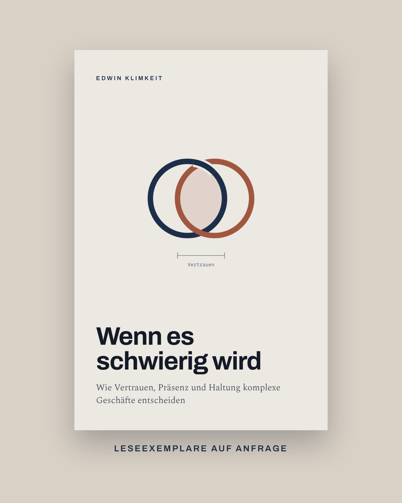

# Wenn es schwierig wird: LinkedIn-Kampagne

Begleitmaterial für LinkedIn zum Buch **„Wenn es schwierig wird. Wie Vertrauen, Präsenz und Haltung komplexe Geschäfte entscheiden.“** von Edwin Klimkeit. Das Buch erscheint im Selbstverlag.

  

## Inhalt

| Datei | Wofür |
| :-- | :-- |
| [linkedin-posts.md](linkedin-posts.md) | Alle LinkedIn-Texte zum Kopieren, mit Postingplan |
| [bilder/linkedin-visual-hochformat.png](bilder/linkedin-visual-hochformat.png) | Bild für Posts, 1200 × 1500 Pixel (4:5), beste Wahl für den Feed |
| [bilder/linkedin-visual-quadrat.png](bilder/linkedin-visual-quadrat.png) | Bild für Posts, 1200 × 1200 Pixel (1:1) |
| [bilder/buchcover-2b.png](bilder/buchcover-2b.png) | Das Cover allein, 1120 × 1680 Pixel |

## So postest du

1. Text aus [linkedin-posts.md](linkedin-posts.md) kopieren.
2. Bild anhängen: am besten das Hochformat.
3. Posten zwischen 7:30 und 9:00 Uhr, Dienstag bis Donnerstag.
4. Direkt danach den Link als ersten eigenen Kommentar setzen, nicht in den Post.
5. In der ersten Stunde auf jeden Kommentar antworten.

## Hinweise

- **Cover:** Entwurf 2b mit Rostrot auf warmem Grund. Es ist noch nicht final abgenommen. Ändert sich das Cover, werden die Bilder neu erzeugt.
- **Inhalte:** Das Buch ist noch nicht veröffentlicht. Die Posts teasern nur an und geben keine längeren Passagen aus dem Manuskript wieder.
- **Diskretion:** Keine Kunden- und keine Arbeitgebernamen in den Posts.

## Blog

Die Artikel zu den Posts erscheinen auf [mind-sales.blog](https://mind-sales.blog). Jeder Artikel wird erst nach Freigabe veröffentlicht.
